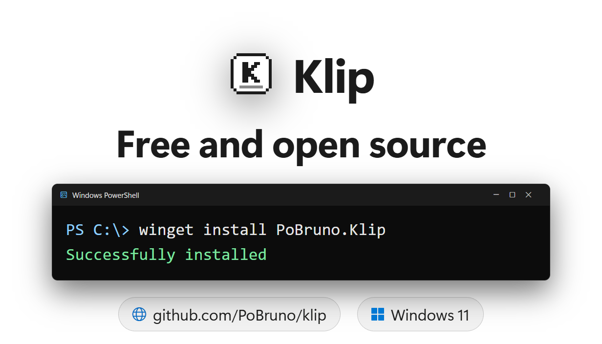
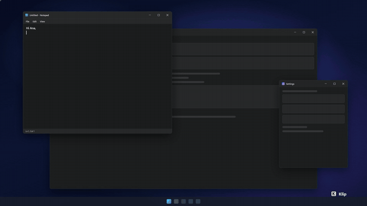
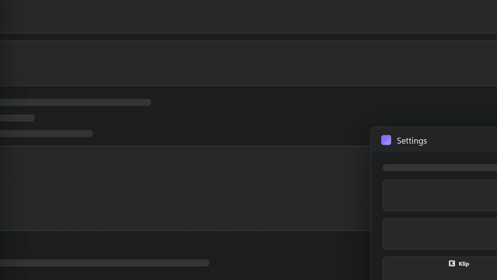
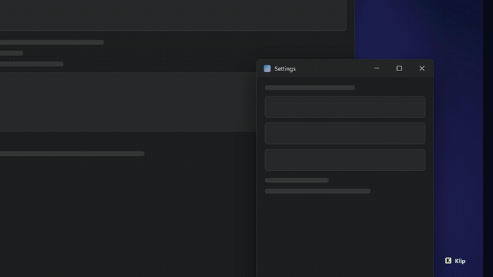
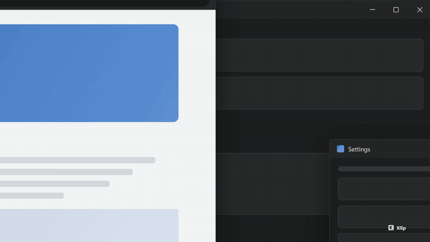
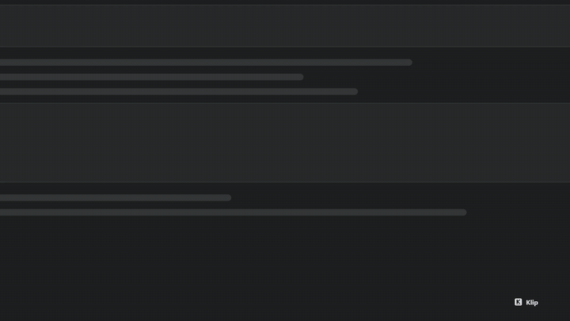
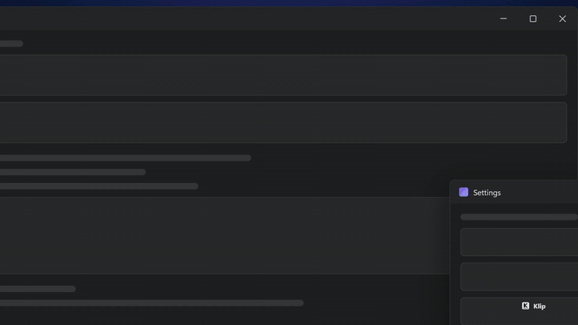

<p align="center">
  <picture>
    <source media="(prefers-color-scheme: dark)" srcset="docs/hero-dark.png">
    <source media="(prefers-color-scheme: light)" srcset="docs/hero-light.png">
    
  </picture>
</p>

<p align="center">
<a href="https://github.com/PoBruno/klip/actions/workflows/ci.yml"></a>
<a href="https://github.com/PoBruno/klip/releases/latest"></a>
<a href="LICENSE"></a>

</p>

<p align="center"><b>Histórico de clipboard, captura e gravação de tela para o Windows 11, sem os limites do nativo.</b></p>

<p align="center">
<a href="#instalar">Instalar</a> · <a href="#destaques">Destaques</a> · <a href="docs/FEATURES-pt.md">Todos os recursos</a> · <a href="#compilar-a-partir-do-código">Compilar</a>
</p>

## Instalar

```powershell
winget install PoBruno.Klip
```

ou **[baixe o instalador](https://github.com/PoBruno/klip/releases/latest)** (ou o exe portable) na última release.

## Por que o Klip

Trabalho com TI há mais de dez anos, a maior parte deles no Windows. As ferramentas que eu mais uso são as pequenas: copiar, colar, tirar um print, pegar um texto da tela, achar aquilo que eu copiei uma hora atrás. O Windows tem versões nativas de todas elas, o Win+V e a Ferramenta de Captura, e eu gosto do visual e do jeito delas. Elas só param cedo demais: histórico curto e sem busca de verdade, um editor de captura sem metade das ferramentas, nenhum jeito de colar um print como arquivo.

O Klip é a versão que eu queria que o Windows tivesse. Mesmo visual, mesmos atalhos, e o fluxo inteiro num lugar só: copiar, capturar, gravar, editar, colar. Antes de escrever, estudei ferramentas open source como o Ditto e o ShareX e a documentação do Win32 para ver até onde um app nativo podia ir. Conheço bem .NET, e foi isso que tornou o Klip possível.

**Como ele continua instantâneo**
- WPF nativo no .NET 10, compilado com ReadyToRun. Sem Electron, sem navegador.
- Histórico em SQLite com FTS5: a busca roda fora da thread de UI e a lista lê só uma prévia curta de cada item.
- O painel do Win+V fica pronto em memória e nunca rouba o foco (`WS_EX_NOACTIVATE`), então a colagem cai onde você estava digitando.
- Os hooks de teclado rodam numa thread própria e só enquanto precisa, então digitar nunca espera pelo Klip.
- Clipboard via `AddClipboardFormatListener`, respeitando os formatos que os gerenciadores de senha usam para ficar fora do histórico.
- Gravação via Media Foundation e Direct3D 11 com o encoder de hardware.
- Tudo fica na sua máquina. Sem conta, sem telemetria.

## Destaques

<table>
<tr>
<td width="50%" valign="top">

<h3>Um histórico que acompanha você</h3>



Tudo o que você copia, com busca enquanto digita, favoritos fixados no topo, filtro por data e abas por tipo. Abre no Win+V, bem ao lado do cursor de texto.

</td>
<td width="50%" valign="top">

<h3>Colar em sequência</h3>



Copiou um usuário e uma senha? Ctrl+clique nos dois no painel e cada Ctrl+V cola o próximo: usuário, Tab, senha. Com Shift+clique, cola tudo de uma vez, um por linha.

</td>
</tr>
<tr>
<td width="50%" valign="top">

<h3>Colar imagem como arquivo</h3>



Copie ou capture uma imagem, abra qualquer pasta no Explorer (ou a área de trabalho) e aperte Ctrl+V: o Klip salva ali como png. Funciona também com imagens do navegador e da Ferramenta de Captura.

</td>
<td width="50%" valign="top">

<h3>Capturar a página inteira</h3>



O Win+Shift+S com tudo o que a Ferramenta de Captura deixa de fora: captura com rolagem para páginas maiores que a tela, texto (OCR), conta-gotas e fixar na tela.

</td>
</tr>
<tr>
<td width="50%" valign="top">

<h3>Marque qualquer imagem</h3>



O editor de imagem é um quadro branco: cole uma imagem, destaque, desenhe setas, escreva e borre o que é privado. Cada edição volta para o clipboard.

</td>
<td width="50%" valign="top">

<h3>Corte suas gravações</h3>



Grave uma região em MP4 ou GIF, depois divida, apare e reordene no editor de vídeo, com várias faixas, e exporte de novo.

</td>
</tr>
</table>

## Recursos

- **Histórico de clipboard:** ilimitado, busca em texto completo, favoritos, abas por tipo, snippets, modo coleta, seletor de emoji, colar como texto puro.
- **Colar vários:** Shift+clique para colar juntos, Ctrl+clique para colar em sequência.
- **Captura de tela:** retângulo, janela, tela cheia, forma livre, rolagem, texto (OCR), conta-gotas, fixar na tela.
- **Colar como arquivo:** Ctrl+V de uma imagem em qualquer pasta do Explorer ou na área de trabalho vira um png.
- **Gravação:** qualquer região em MP4 (até 60 fps, som do sistema e microfone) ou direto em GIF.
- **Editor de imagem:** quadro branco, anotações, borrar e ocultar dados sensíveis automaticamente, remover fundo.
- **Editor de vídeo:** dividir, aparar, várias faixas, exportar em MP4 ou GIF.
- **Nativo:** assume o Win+V e o Win+Shift+S se você quiser, 15 idiomas, backup do histórico em `.zip`.

Todos os recursos e atalhos: **[docs/FEATURES-pt.md](docs/FEATURES-pt.md)**

## Bom saber

- **Os atalhos padrão são `Ctrl+Shift+V` e `Ctrl+Shift+S`.** O Klip pergunta antes de assumir o `Win+V` ou o `Win+Shift+S`, e você devolve quando quiser em Configurações > Atalhos.
- **Desinstalar devolve as teclas ao Windows.** Seu histórico fica em `%LOCALAPPDATA%\Klip` até você apagar.
- **Instalador ou portable:** é o mesmo app. O instalador cria a entrada no menu Iniciar e o desinstalador; no exe portable, restaure os atalhos padrão nas Configurações antes de apagar.

## Compilar a partir do código

Você precisa do **SDK do .NET 10** e do Windows 11.

```powershell
git clone https://github.com/PoBruno/klip.git
cd klip

dotnet build Klip.sln            # compilar
dotnet test Klip.sln             # rodar os testes (xunit)
dotnet run --project src/Klip.App   # rodar o app (aparece na bandeja)
```

Empacotar:

```powershell
.\tools\build-installer.ps1    # instalador + exe portable -> dist\
.\tools\check-release.ps1      # as mesmas checagens do workflow de release
```

O script do instalador precisa do [Inno Setup 6](https://jrsoftware.org/isdl.php). O Klip não é distribuído como MSIX de propósito: o sandbox bloqueia a troca de atalhos e o hook global de teclado que ele usa.

## Contribuir

Issues e pull requests são bem-vindos. Pensando em algo maior? Abra uma issue antes para a gente conversar.

## Créditos

- Junção da captura com rolagem inspirada no [ShareX](https://github.com/ShareX/ShareX) (só a abordagem, nenhum código reaproveitado).
- Arte dos emojis do [Twemoji](https://github.com/jdecked/twemoji), [CC-BY 4.0](https://creativecommons.org/licenses/by/4.0/). Nomes dos emojis do [Unicode CLDR](https://cldr.unicode.org/).

## Licença

O Klip é distribuído sob a [GNU GPLv3](LICENSE).

---

English? See the [README.md](README.md).
