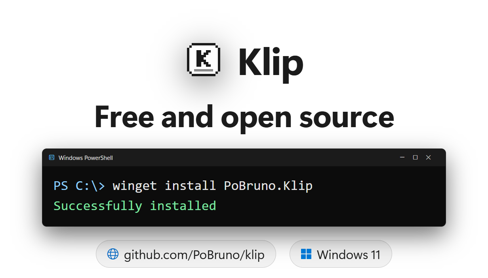
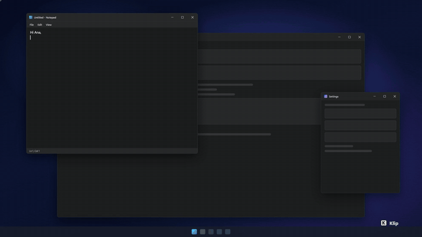
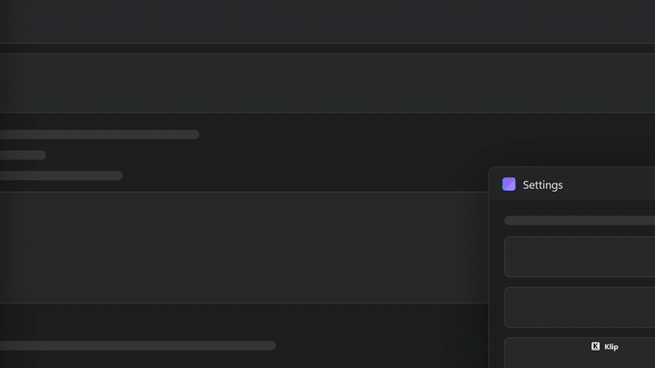
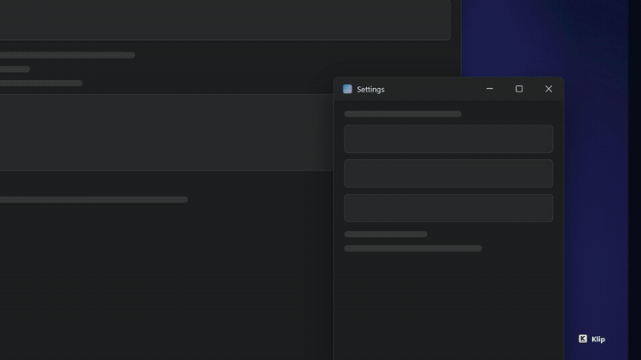
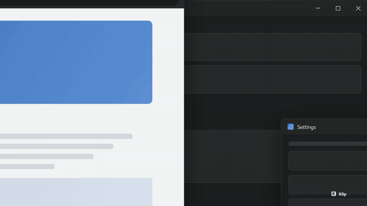
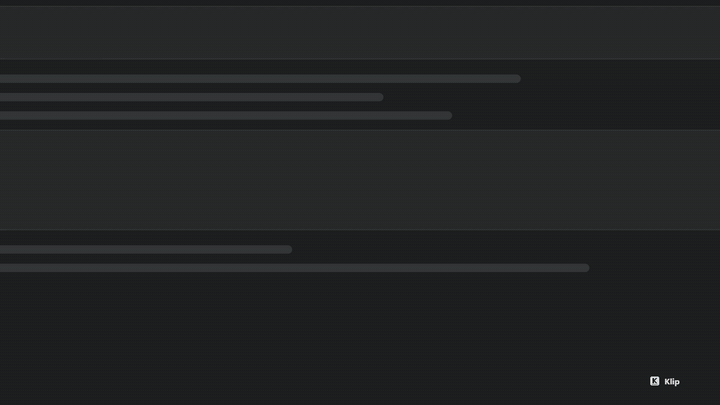
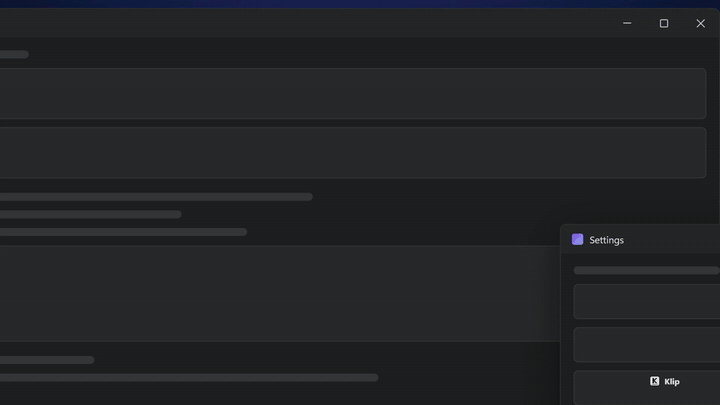

<p align="center">
  <picture>
    <source media="(prefers-color-scheme: dark)" srcset="docs/hero-dark.png">
    <source media="(prefers-color-scheme: light)" srcset="docs/hero-light.png">
    
  </picture>
</p>

<p align="center">
<a href="https://github.com/PoBruno/klip/actions/workflows/ci.yml"></a>
<a href="https://github.com/PoBruno/klip/releases/latest"></a>
<a href="LICENSE"></a>

</p>

<p align="center"><b>Clipboard history, screen capture and recording for Windows 11, without the native limits.</b></p>

<p align="center">
<a href="#install">Install</a> · <a href="#highlights">Highlights</a> · <a href="docs/FEATURES.md">All features</a> · <a href="#build-from-source">Build from source</a>
</p>

## Install

```powershell
winget install PoBruno.Klip
```

or **[download the installer](https://github.com/PoBruno/klip/releases/latest)** (or the portable exe) from the latest release.

## Why Klip

I have worked in IT for over ten years, most of them on Windows. The tools I use the most are the small ones: copy, paste, take a screenshot, grab some text off the screen, find that thing I copied an hour ago. Windows ships native versions of all of them, Win+V and the Snipping Tool, and I like how they look and feel. They just stop too early: a short history with no real search, a capture editor missing half the tools, no way to paste a screenshot as a file.

Klip is the version I wanted Windows to ship. Same look, same shortcuts, and the whole flow in one place: copy, capture, record, edit, paste. Before writing it I went through open source tools like Ditto and ShareX and the Win32 docs to see how far a native app could go. I know .NET well, which made it possible.

**How it stays instant**
- Native WPF on .NET 10, compiled ReadyToRun. No Electron, no browser.
- History in SQLite with FTS5: search runs off the UI thread and the list only reads a short preview of each item.
- The Win+V panel is kept warm and never takes focus (`WS_EX_NOACTIVATE`), so the paste lands right where you were typing.
- Keyboard hooks live on their own thread and only while needed, so typing never waits on Klip.
- Clipboard through `AddClipboardFormatListener`, respecting the formats password managers use to stay out of history.
- Recording through Media Foundation and Direct3D 11 with the hardware encoder.
- Everything stays on your machine. No account, no telemetry.

## Highlights

<table>
<tr>
<td width="50%" valign="top">

<h3>A clipboard history that keeps up</h3>



Everything you copy, searchable as you type, with favorites pinned on top, date filters and tabs per type. It opens on Win+V, right at the text caret.

</td>
<td width="50%" valign="top">

<h3>Paste in sequence</h3>



Copied a username and a password? Ctrl+click both in the panel and every Ctrl+V pastes the next one: username, Tab, password. Shift+click instead pastes them all at once, one per line.

</td>
</tr>
<tr>
<td width="50%" valign="top">

<h3>Paste an image as a file</h3>



Copy or capture an image, open any folder in Explorer (or the desktop) and press Ctrl+V: Klip saves it there as a png. Works with images from the browser and the Snipping Tool too.

</td>
<td width="50%" valign="top">

<h3>Capture a whole page</h3>



Win+Shift+S with everything the Snipping Tool leaves out: scrolling capture for pages taller than the screen, text (OCR), color picker and pin to screen.

</td>
</tr>
<tr>
<td width="50%" valign="top">

<h3>Mark up any image</h3>



The image editor is a whiteboard: paste an image, highlight, draw arrows, add text and blur what is private. Every edit goes back to the clipboard.

</td>
<td width="50%" valign="top">

<h3>Cut your recordings</h3>



Record a region to MP4 or GIF, then split, trim and reorder it in the video editor, across multiple tracks, and export again.

</td>
</tr>
</table>

## Features

- **Clipboard history:** unlimited, full text search, favorites, tabs per type, snippets, collect mode, emoji picker, plain text paste.
- **Multi paste:** Shift+click to paste several items together, Ctrl+click to paste them in sequence.
- **Screen capture:** rectangle, window, full screen, free form, scrolling capture, text (OCR), color picker, pin to screen.
- **Paste as file:** Ctrl+V an image into any Explorer folder or the desktop and it becomes a png.
- **Recording:** any region to MP4 (up to 60 fps, system audio and mic) or straight to GIF.
- **Image editor:** whiteboard canvas, annotations, blur and auto redact, background remove.
- **Video editor:** split, trim, multiple tracks, export to MP4 or GIF.
- **Native:** takes over Win+V and Win+Shift+S if you want, 15 languages, history backup as `.zip`.

Every feature and shortcut: **[docs/FEATURES.md](docs/FEATURES.md)**

## Good to know

- **Default keys are `Ctrl+Shift+V` and `Ctrl+Shift+S`.** Klip asks before taking over `Win+V` or `Win+Shift+S`, and you can give them back any time in Settings > Shortcuts.
- **Uninstalling gives the Windows keys back.** Your history stays in `%LOCALAPPDATA%\Klip` until you delete it.
- **Installer or portable:** same app. The installer adds the Start menu entry and the uninstaller; with the portable exe, restore the default shortcuts in Settings before deleting it.

## Build from source

You need the **.NET 10 SDK** and Windows 11.

```powershell
git clone https://github.com/PoBruno/klip.git
cd klip

dotnet build Klip.sln            # build
dotnet test Klip.sln             # run the tests (xunit)
dotnet run --project src/Klip.App   # run the app (shows up in the tray)
```

Packaging:

```powershell
.\tools\build-installer.ps1    # installer + portable exe -> dist\
.\tools\check-release.ps1      # the same checks the release workflow runs
```

The installer script needs [Inno Setup 6](https://jrsoftware.org/isdl.php). Klip is not shipped as MSIX on purpose: the sandbox blocks the shortcut takeover and the global keyboard hook it relies on.

## Contributing

Issues and pull requests are welcome. Planning something bigger? Open an issue first so we can talk it through.

## Credits

- Scrolling capture stitching inspired by [ShareX](https://github.com/ShareX/ShareX) (approach only, no reused code).
- Emoji artwork from [Twemoji](https://github.com/jdecked/twemoji), [CC-BY 4.0](https://creativecommons.org/licenses/by/4.0/). Emoji names from the [Unicode CLDR](https://cldr.unicode.org/).

## License

Klip is released under the [GNU GPLv3](LICENSE).

---

Portugues? Veja o [README-pt.md](README-pt.md).
